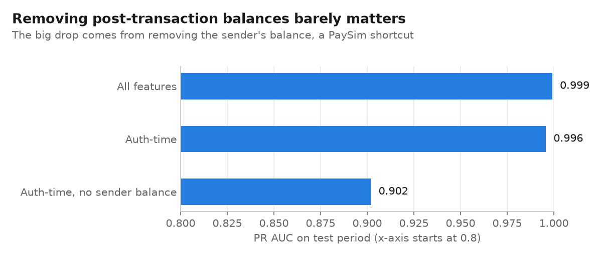
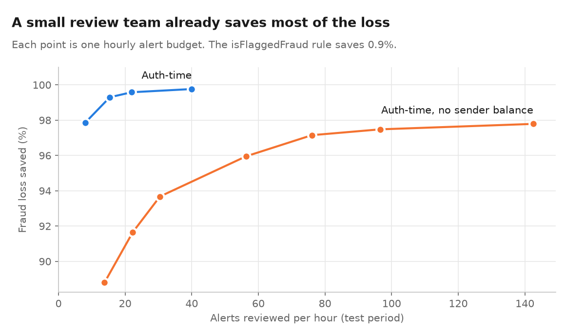

# Mobile-Money Fraud Detection: Judged in Naira, Audited for Leakage

A fraud detection project on mobile-money transactions that asks two questions most fraud notebooks skip:

1. **Is the model's score real, or is it leakage?** Some columns are only known *after* a transaction completes. A model that uses them looks near-perfect but could never run at authorisation time.
2. **What is the model worth in money?** Accuracy means little when fraud is rare. This project picks the alert threshold by cost (missed fraud vs. analyst review) and reports results as naira saved, not percentages.

## Key findings

- **The near-perfect score is not leakage, but it is not realistic either.** Dropping the post-transaction balances barely moves the score (PR AUC 0.999 → 0.996). The real driver is a simulator shortcut: 98% of frauds empty the sender's account and no normal transaction does. Without the sender's balance, PR AUC falls to 0.90.
- **The existing rule saves under 1% of fraud losses.** `isFlaggedFraud` is never wrong, but it catches 13 of 4,812 test frauds (₦71m of ₦7.5bn).
- **The realistic model saves ₦7.34bn (98% of losses)** at the real fraud rate, after paying ₦500 to review every alert.
- **Alert on expected loss, not on probability.** Alerting when probability × amount > ₦500 beats a tuned probability threshold and needs no tuning.
- **A small team still saves most of the loss.** At about 10 alerts an hour, the realistic model saves 89% of losses. The next 130 alerts an hour add only 9 more points.

Run everything with `python -m src.run_all`.

## Dataset

A sample of [PaySim](https://www.kaggle.com/datasets/ealaxi/paysim1), a synthetic mobile-money simulation built from real transaction logs.

| | |
|---|---|
| Rows | 108,213 transactions |
| Fraud cases | 8,213 (7.6% of the sample) |
| Fraud rate in full PaySim | ~0.13% |
| Transaction types | CASH_IN, CASH_OUT, DEBIT, PAYMENT, TRANSFER |

The file is not committed. Place it at `data/raw/fraud_data.csv`.

### What an initial look showed

- **Fraud only happens in TRANSFER and CASH_OUT.** The other three types have zero fraud cases.
- **The sample is rebalanced.** All frauds were kept and normal transactions were cut down, so fraud is ~58x more common here than in the full data. Metrics like precision must be re-weighted back to the real base rate before they mean anything.
- **Balance columns almost give the label away.** In 98% of frauds the amount equals the sender's full balance (the account is drained); no normal transaction does this. About half of frauds leave the receiver's balance at zero before and after, which happens in 0.02% of normal transfers. Part A tests whether this is true leakage or something else.
- **The `date` column is unreliable.** It does not line up with `step` (the hour of the simulation), so `step` is used as the time axis and `date` is dropped.
- **The existing rule flag is weak.** `isFlaggedFraud` catches 16 of 8,213 frauds. That is the baseline to beat.
- **Account IDs almost never repeat**, so per-account history and network features are not possible with this sample.

## Data preparation (`src/data.py`)

- Drops the two old index columns and `date`.
- Keeps only TRANSFER and CASH_OUT, since no other type has fraud. That leaves **51,704 rows with all 8,213 frauds (15.9%)**.
- Sorts by `step` so later splits can follow time order.
- Adds `is_transfer` (1 = TRANSFER, 0 = CASH_OUT) and `hour` (`step % 24`).
- Defines two feature sets for Part A:

| Set | Columns | Meaning |
|---|---|---|
| Auth-time | `amount`, `oldbalanceOrg`, `oldbalanceDest`, `is_transfer`, `hour` | Known when the transaction is requested |
| All | auth-time + `newbalanceOrig`, `newbalanceDest` | Adds balances that only exist after the transaction goes through |

`isFraud` is the label. `isFlaggedFraud` is kept only as the rule baseline and is never a model input.

Run `python -m src.data` to print a summary, and `pytest` to run the tests.

### Train/test split by time

The model trains on the first 300 simulated hours (`step` 1–300) and is tested on the later hours (301–743). It never sees the future.

| | Rows | Frauds | Fraud rate |
|---|---|---|---|
| Train (steps 1–300) | 31,498 | 3,401 | 10.8% |
| Test (steps 301–743) | 20,206 | 4,812 | 23.8% |

The test set has a higher fraud rate because PaySim's normal transaction volume drops sharply after step ~400 while fraud stays steady. Part B re-weights to the real base rate, so this does not distort the cost results.

## Part A results: leakage audit (`src/leakage_audit.py`)

The same LightGBM model (300 trees, fixed seed) was trained on three feature sets and scored on the later test period.

| Feature set | Columns | ROC AUC | PR AUC |
|---|---|---|---|
| All | auth-time + post-transaction balances | 0.9998 | 0.9992 |
| Auth-time | known when the transaction is requested | 0.9987 | 0.9958 |
| Auth-time without sender balance | auth-time minus `oldbalanceOrg` | 0.9439 | 0.9021 |



**What this shows**
- **Leakage in time is small.** Removing the post-transaction balances (`newbalanceOrig`, `newbalanceDest`) barely changes the score (PR AUC 0.9992 → 0.9958).
- **The near-perfect score comes from a simulator shortcut, not leakage.** In PaySim, fraud almost always empties the sender's account and normal transactions never do. The sender's starting balance (`oldbalanceOrg`) is known at authorisation time, so it is fair to use, but this clean split is unlikely in real fraud.
- **Without that shortcut, the model is good but not perfect** (PR AUC 0.90). This is a more realistic picture of what the other signals can do.

Results are saved to `reports/leakage_audit.csv`. Run with `python -m src.leakage_audit`.

## Part B results: cost in naira (`src/cost_eval.py`)

**Set-up**
- **Real fraud rate.** Each normal test transaction is weighted by 63.5, which is how many real PaySim normal TRANSFER/CASH_OUT transactions each sampled row stands for. After weighting, the test period holds about 977,000 normal transactions and 4,812 frauds.
- **Costs.** Every alert is reviewed at ₦500. A caught fraud is stopped, and a missed fraud costs its full amount. PaySim does not name a currency, so amounts are treated as naira.
- **No peeking at the test set.** The model trains on steps 1–240. The probability threshold is chosen on steps 241–300 and then applied unchanged to the test period (301–743).
- **Two ways to alert.**
  - *Threshold:* alert when the model's probability is above one fixed cut-off.
  - *Expected loss:* convert the probability to the real fraud rate, then alert when probability × amount > ₦500. This needs no tuning and weighs large transfers more.

**Test period (steps 301–743)**

| Strategy | Alerts | Frauds caught (of 4,812) | Precision | Total cost (₦) | Saved vs no alerts (₦) |
|---|---|---|---|---|---|
| No alerts | 0 | 0 | — | 7,504,857,638 | 0 |
| `isFlaggedFraud` rule | 13 | 13 | 100% | 7,433,912,094 | 70,945,544 |
| Auth-time, threshold 0.172 | 22,326 | 4,733 | 21.2% | 18,009,398 | 7,486,848,241 |
| Auth-time, expected loss | 17,726 | 4,579 | 25.8% | 17,771,986 | 7,487,085,652 |
| No sender balance, threshold 0.099 | 62,565 | 4,071 | 6.5% | 178,187,413 | 7,326,670,225 |
| No sender balance, expected loss | 63,150 | 3,957 | 6.3% | 165,963,412 | 7,338,894,227 |

**What this shows**
- **The existing rule barely helps.** It is never wrong, but it catches 13 of 4,812 frauds and saves under 1% of the losses.
- **Any model saves far more.** Fraud amounts are large (average ₦1.47m) and a review costs only ₦500, so the best strategy is to alert widely. Even with ~5 false alarms per real fraud, the reviews pay for themselves.
- **The realistic figure is the model without the sender balance.** It saves about ₦7.34bn (98% of losses), compared with ₦7.49bn for the auth-time model. Most of the auth-time model's edge comes from the PaySim shortcut found in Part A.
- **Expected-loss alerting beats a single threshold,** and it needs no tuning. It accepts missing some small frauds to catch the large ones.
- **Alert volume is the real constraint.** 63,000 alerts across 443 hours is about 140 an hour. A real team may not have that capacity, which would push the threshold up.

Results are saved to `reports/cost_results.csv`. Run with `python -m src.cost_eval`.

### With a limited review team (`src/capacity.py`)

A real team can only review so many alerts an hour. For each hourly budget, the expected-loss cut-off is set on the validation period so that alerts stay within the budget. It is then applied unchanged to the test period, and it never drops below ₦500.



| Budget (alerts/hour) | Auth-time: alerts/hour on test | Auth-time: loss saved | No sender balance: alerts/hour on test | No sender balance: loss saved |
|---|---|---|---|---|
| 10 | 8.0 | 97.9% | 13.8 | 88.8% |
| 25 | 15.4 | 99.3% | 22.3 | 91.7% |
| 50 | 21.9 | 99.6% | 30.5 | 93.7% |
| 100 | 40.0 | 99.8% | 56.3 | 96.0% |
| 200 | 40.0 | 99.8% | 96.6 | 97.5% |
| No limit | 40.0 | 99.8% | 142.6 | 97.8% |

**What this shows**
- **Even a small team saves most of the loss.** At about 10 alerts an hour, the realistic model (no sender balance) still saves 89% of fraud losses. It works because the expected-loss score puts the largest likely frauds first.
- **Returns drop off fast.** For the realistic model, going from 10 to 50 alerts an hour adds 5 points of savings, and going from 50 to the full 143 adds only 4 more.
- **Budgets set on past data drift.** The test period has more fraud than the validation period, so the realistic model goes over its budget at small sizes (13.8 an hour against a budget of 10). In production the cut-off would need regular re-tuning.

Run with `python -m src.capacity`, then `python -m src.figures` to redraw both charts.

## Limitations

- **Synthetic data.** PaySim imitates real logs, but its fraud is simpler than real fraud. The account-draining pattern is the clearest example. Real results would be lower, likely closer to the no-sender-balance model or below it.
- **Assumed costs.** Amounts are treated as naira and a review is assumed to cost ₦500. Reviews are assumed to stop every fraud they look at. Customer friction from false alarms (blocked payments, complaints) is not counted.
- **Re-weighting assumption.** Weighting each normal row by 63.5 assumes the sample's normal transactions were drawn at random across all hours.
- **One time split.** Results come from one train/validation/test split with no confidence intervals. The test period also has a higher fraud share than training, because PaySim's normal volume drops after step ~400.
- **No account history.** Account IDs almost never repeat in this sample, so features like "first transfer to this receiver" or transaction velocity could not be built. In practice these are some of the strongest fraud signals.

## Project structure

```
mobile-money-fraud/
├── data/raw/            # fraud_data.csv goes here (git-ignored)
├── src/
│   ├── data.py          # load, clean, feature sets, time split
│   ├── leakage_audit.py # Part A
│   ├── cost_eval.py     # Part B
│   ├── capacity.py      # limited review team scenario
│   ├── figures.py       # README charts
│   └── run_all.py       # runs everything above
├── tests/               # pytest tests (16)
├── reports/             # result CSVs
│   └── figures/         # README charts
├── requirements.txt
└── README.md
```

## Setup (Windows, PowerShell)

```powershell
python -m venv .venv
.venv\Scripts\Activate.ps1
pip install -r requirements.txt
```

Place the data at `data/raw/fraud_data.csv`, then:

```powershell
python -m src.run_all   # all results and figures
pytest                  # 16 tests
```
